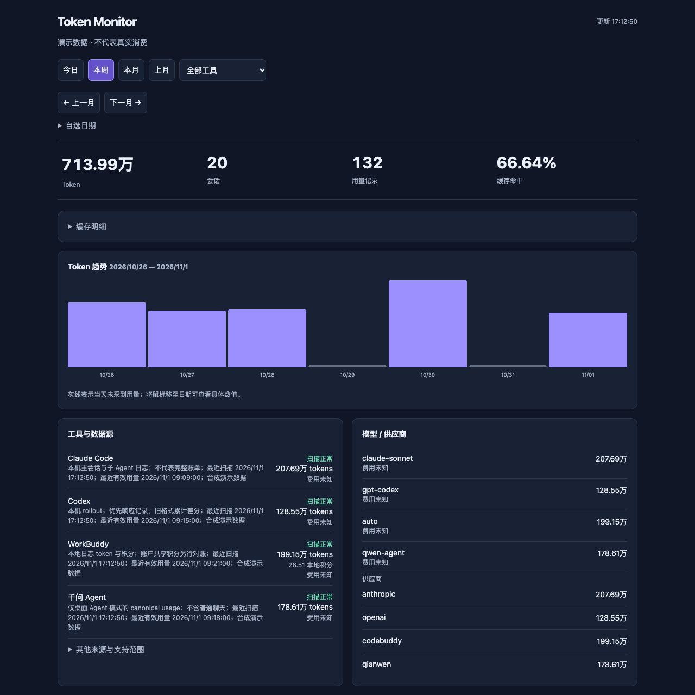
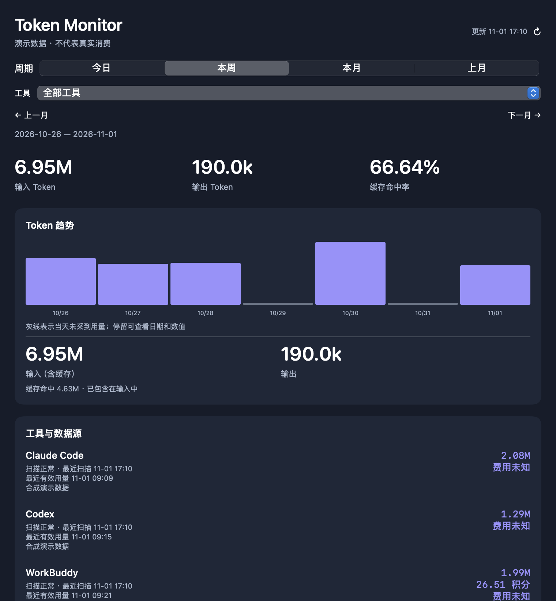

<div align="center">

# Token Monitor

### 多个 AI 工具，一张本地用量看板。

**Claude Code · Codex · WorkBuddy · 千问 Agent**

macOS 菜单栏 + 网页历史查询 · 免 API key · 数据留在本机 · MIT

[快速开始](#快速开始) · [支持范围](#支持范围) · [隐私](SECURITY.md) · [参与改进](CONTRIBUTING.md)

</div>



> 所有展示图片均为合成演示数据，不代表真实消费。支持范围以各工具可读取的本地日志为准。

## 为什么做这个

今天在 Codex 写代码，转到 WorkBuddy 处理文件，又在 Claude Code 里跑了几轮 Agent。想回头看一周用了多少，不应该分别去翻几套日志。

Token Monitor 将不同工具的本地 usage 归到同一条时间轴：菜单栏随手看，网页按工具、日期和月份回顾。

- **多工具汇总**：一个看板看 Claude Code、Codex、WorkBuddy、千问 Agent；同时保留各工具明细。
- **原生菜单栏**：点开即看输入、输出、缓存命中率、趋势和来源状态，登录后自动采集。
- **能回顾的历史**：今日、本周、本月、上月、前后翻月及网页自选日期；零值日期保留位置。
- **口径讲清楚**：输入已包含缓存；本地积分、账户额度和 token 分开显示；未知值不会伪装成 0。
- **本地优先**：免账号、免 API key、无遥测；只读日志，不改宿主配置。Python 运行时仅使用标准库。

<details>
<summary>看看原生面板</summary>



</details>

## 快速开始

首版专注 **macOS**，不要求 Docker、Node 或数据库服务。需要 **Python 3.10+**；原生面板另外需要 Xcode Command Line Tools。安装不使用 sudo，不需要填写密钥。

### 从源码安装

下载或克隆本项目后，在目录中执行：

```sh
sh install.sh
```

安装后会启动菜单栏和后台采集，并设置登录启动。默认扫描已有本地日志，通常数秒后可在 [本地看板](http://127.0.0.1:8787/) 看到数据；首次导入较大历史可能需要更久。没有日志时显示空状态。

仅使用网页、不构建菜单栏：

```sh
sh install.sh --web-only
```

若缺少依赖：

```sh
brew install python@3.13    # 已有 Python 3.10+ 则不需要
xcode-select --install     # 仅原生面板需要
```

安装器会寻找支持的 Python。也可用 `TOKEN_MONITOR_PYTHON` 指定现有解释器。命令默认安装到 `~/.local/bin`；若终端找不到命令，将此目录加入 PATH，或直接运行 `~/.local/bin/token-monitor`。

### 一键下载 / Homebrew

源码安装现在即可使用。维护者发布 `v0.1.0` Release 后，可用以下下载方式；Release 创建前请使用上面的源码安装。

```sh
curl -fsSL https://raw.githubusercontent.com/spiritn/token-monitor/v0.1.0/install.sh | sh
```

安装器会校验源码包 SHA-256，再在本机构建。可先下载并阅读脚本，再执行。

Homebrew 配方与源码放在同一仓库，无需额外维护一个 tap 仓库。发布源码包与对应配方后：

```sh
brew tap spiritn/token-monitor https://github.com/spiritn/token-monitor
brew install spiritn/token-monitor/token-monitor
token-monitor start
```

Homebrew 负责 Python 依赖，面板在本机构建。**Homebrew 路径尚未完成远端安装验证。** 当前不提供需要绕过 Gatekeeper 的未公证应用下载。

## 日常使用

```sh
token-monitor open                 # 打开网页
token-monitor status               # 查看状态与数据位置
token-monitor doctor               # 排查 Python、端口、后台和面板
token-monitor start --port 8788     # 默认端口冲突时改用其他端口
token-monitor stop                 # 当前停止；下次登录仍会启动
token-monitor uninstall            # 移除登录启动；源码安装同时移除程序，保留历史
```

重新运行安装命令即可升级，上一版程序保留为 `.previous`。Homebrew 用户卸载前先运行 `token-monitor uninstall`，再运行 `brew uninstall token-monitor`。

程序与历史数据分开保存：

| 内容 | 默认位置 |
| --- | --- |
| 源码安装的程序 | `~/.local/share/token-monitor` |
| 历史、配置与诊断日志 | `~/Library/Application Support/TokenMonitor` |
| 本地页面 | `http://127.0.0.1:8787` |

通常无需配置。需要改时区时，编辑数据目录里的 `config.json`，再运行 `token-monitor start`：

```json
{"port": 8787, "timezone": "Asia/Shanghai"}
```

安装目录、命令目录和数据目录可分别通过 `TOKEN_MONITOR_INSTALL_DIR`、`TOKEN_MONITOR_BIN_DIR`、`TOKEN_MONITOR_DATA_DIR` 指定。不会读取旧个人版监控目录或搬走其数据库。

## 支持范围

| 工具 | 读取来源 | 覆盖与限制 |
| --- | --- | --- |
| Claude Code | `~/.claude/projects/**/*.jsonl` | 主会话与子 Agent 的响应 usage，按响应去重 |
| Codex | `~/.codex/sessions`、`archived_sessions` | 响应记录优先，旧格式累计差分；**分页历史暂未完整支持** |
| WorkBuddy | `~/.workbuddy/projects/**/*.jsonl` | 本地 token、缓存和本地积分；不是账户完整账单 |
| 千问 Agent | 本地 `qwen-agent` 的 canonical usage | 仅 Agent 模式，不含普通聊天 |
| DeepSeek Harness | 未压缩 `session.jsonl` | 实验适配，尚无本机实用样本验证 |
| ChatGPT / 豆包普通聊天 | 无已验证的本地 usage 源 | 暂不支持，页面明确说明 |

**不要把本地用量当作完整账单。** 删除的日志、没有写入 usage 的请求、格式变化和其他设备的消费可能不可见。“扫描正常”只表示读取正常；页面同时展示最近有效用量和覆盖提示。

默认不预置易过期的模型价格，也不读取网站账户。WorkBuddy 的“本地积分”不是共享账户的剩余额度。Codex 额度快照仅来自日志，时间与当前筛选范围独立。

## 平台与验证

- 首版面向 macOS；Python 核心可在其他系统做离线测试，但不宣称支持 Windows/Linux 部署。
- 原生面板构建目标为 macOS 11+；目前实机验证为 Intel Mac。低版本 macOS 未逐一验证。
- Apple Silicon 使用本机架构构建；已配置两种 Mac 架构的 CI，远端构建和实机使用仍待验证。
- 不提供“下载后直接双击”的独立应用：当前采用本机构建与 ad-hoc 签名，尚未做 Developer ID 签名和公证。

## 如何工作

```text
各工具本地日志 → 适配器 → SQLite 统一计量 → 菜单栏 / 本地网页
```

每 5 秒补扫；半行等待补齐，事件与游标一起提交，异常记录隔离并提示。请求、累计快照和缓存字段按来源归一化。运行数据与发布文件分离，不将聊天正文写入监控库。

想先看效果，不读取自己的日志：

```sh
python3 scripts/demo.py
# 打开 http://127.0.0.1:18788/
```

开发与发布步骤见 [CONTRIBUTING](CONTRIBUTING.md) 和 [发布说明](docs/releasing.md)。欢迎提交经过合成处理的格式样本，一起补充更多工具。

## License

[MIT](LICENSE)
